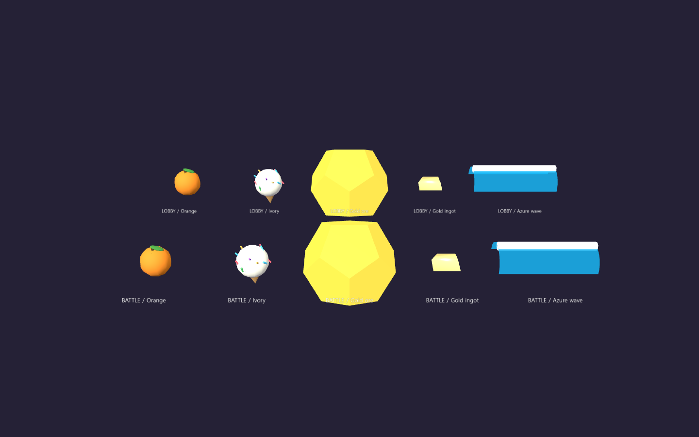

# 베타 로비·대전 일반 공격 연출 검증

2026-10-19 · 베타 0.8.18

## 원인과 수정

로비와 대전은 별도 렌더러를 사용했습니다. 대전에는 금광석·금괴 공통 팔면체, 오렌지·아이스크림 단순 구체, 파도 상자가 남아 있었고, 근접 공격도 공통 선으로 표시했습니다.

두 화면이 같은 모델 생성 함수를 사용하도록 연결했습니다. 아이보리 착탄 장판의 콘·스프링클, 퍼플·아이보리 투척 곡선, 레드 2연타·크림슨 3연타·핑크 음표도 대전에 연결했습니다. 봇 위치와 방향으로도 연출을 생성하고 경기 정리 시 남은 연출·예약을 제거합니다.

## 확인

- `node tools/test-beta-attack-visuals-browser.mjs`: 실제 Edge에서 로비·대전 모델 15쌍의 형태·재질 트리 일치. 16종 일반 공격 각각을 독립된 원래 전투 엔진과 같은 조건으로 실행해 체력·궁 충전량 일치.
- 레드 주먹 2개, 크림슨 부채꼴 3개, 핑크 음표 8개 및 투척 포물선·아이스크림 장판·파도 생성 확인.
- 종료 후 모델·투사체 참조·예약·전투 이펙트가 모두 0개. 페이지 예외 0개. 실제 젬 그랩 진입도 확인.
- `npm.cmd run check`, `npm.cmd run check:beta6`, `node tools/test-beta8-ultimate-balance.mjs` 통과.
- 메인 및 전투 엔진·캐릭터 능력치 파일은 수정하지 않았습니다. 배포 사이트 검증은 포함하지 않습니다.

[상세 결과](beta-attack-visuals-verification.json)

아래는 같은 모델 생성 함수로 렌더한 비교판입니다(위: 로비, 아래: 대전). 실제 경기 화면 캡처는 아닙니다.

