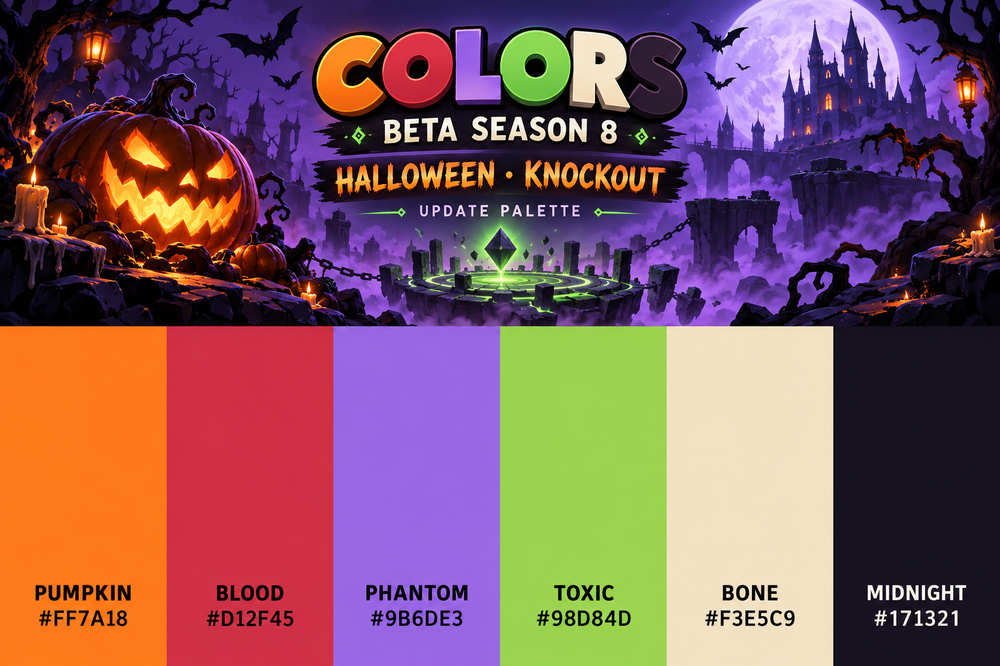

# 베타 시즌 8 업데이트 기념 팔레트

2026-10-14 · 로드맵의 **할로윈 / KNOCKOUT**을 기준으로 만든 색상 팔레트 이미지다. 게임 테마·모드의 구현 완료를 알리는 이미지가 아니다.

| 색상 | HEX | 용도 |
|---|---|---|
| 호박 주황 / PUMPKIN | `#FF7A18` | 호박 조명, 강조 |
| 핏빛 빨강 / BLOOD | `#D12F45` | 위험, 승부 강조 |
| 유령 보라 / PHANTOM | `#9B6DE3` | 안개, 유령빛 |
| 독빛 초록 / TOXIC | `#98D84D` | 마법, 보조 강조 |
| 뼈색 / BONE | `#F3E5C9` | 밝은 글자, 뼈 장식 |
| 한밤색 / MIDNIGHT | `#171321` | 배경, 대비 |

- 파일: `assets/art/beta8-update-palette.png`, 1536×1024 PNG.
- 제작: 내장 image generation 도구. 생성 이미지를 시각적으로 확인했다.
- 이미지는 디자인 참고용이며, 구현 시 사용할 기준 색상은 위 HEX 값이다.
- 로드맵 근거: `index.html`의 SEASON 8 — 할로윈 / KNOCKOUT.

## 생성 프롬프트

Create one finished landscape 3:2 commemorative COLOR PALETTE POSTER for the browser game COLORS, BETA SEASON 8 UPDATE. Follow its actual roadmap: HALLOWEEN theme, KNOCKOUT round-based survival combat. This is a palette concept image, not a screenshot and not an announcement of implemented game features.
Top 45%: stylish Halloween game illustration, original carved jack-o-lantern with orange glow, haunted silhouettes and bats, eerie violet fog, faint green magical glimmers around a small abstract arena emblem. No human characters, no perfume bottles, no flowers, no desert pyramids. Spooky and playful, sophisticated game art, clean graphic composition.
Exact title text: "COLORS". Subtitle: "BETA SEASON 8". Secondary text: "HALLOWEEN · KNOCKOUT". Small caption: "UPDATE PALETTE".
Bottom 55%: six equal clean solid flat-color rectangular vertical swatches, unobstructed, each labeled with exactly one short name and its exact HEX code:
PUMPKIN / #FF7A18
BLOOD / #D12F45
PHANTOM / #9B6DE3
TOXIC / #98D84D
BONE / #F3E5C9
MIDNIGHT / #171321
Keep the swatches exactly these specified solid colors, without gradients or shading. Use crisp readable sans-serif labels, dark text on light swatches and bone-white text on the dark swatch. Generous margins, balanced polished game design poster, sharp typography and exact spelling. All six colors should be easy to compare and use as a design reference. Gradients allowed only in upper illustration. No watermark, no date, no fake reward claims. Opaque background.

