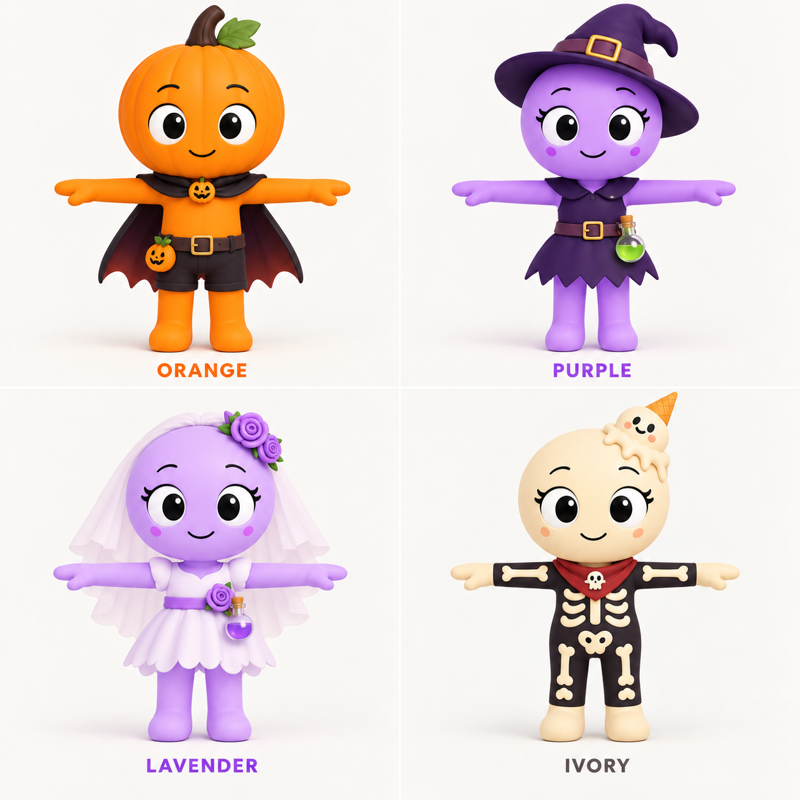

# 시즌 8 할로윈 스킨 — T포즈 콘셉트

2026-10-14 · 할로윈 / KNOCKOUT 로드맵과 [기념 팔레트](beta8-color-palette.md)를 따른 디자인 시안이다. FBX 제작·상점 출시·게임 장착은 아직 적용하지 않았다.

## 캐릭터와 베이스

| 캐릭터 | 스킨 | 성별·참고 베이스 | 주요 장식 |
|---|---|---|---|
| 오렌지 | 잭오랜턴 오렌지 | 남자 · 사용자 제공 기본 애저 | 호박 줄기와 잎, 짧은 망토, 호박 브로치 |
| 퍼플 | 마녀 퍼플 | 여자 · 사용자 제공 기본 민트 | 마녀 모자, 짧은 튜닉, 초록 물약 |
| 라벤더 | 유령 신부 라벤더 | 여자 · 사용자 제공 기본 민트 | 짧은 베일과 드레스, 보라 꽃, 향수병 |
| 아이보리 | 해골 아이보리 | 여자 · 사용자 제공 기본 민트 | 뼈 무늬 의상, 목수건, 유령 아이스크림 장식 |

## 베이스 유지 기준

- 둥근 머리, 큰 흰자·검은 눈동자, 작은 웃는 입, 단순한 몸체와 팔다리를 유지한다.
- 여자 3종은 민트의 속눈썹·얇은 눈썹·부드러운 얼굴을 기준으로 한다. 오렌지는 남자 베이스다.
- 사람형 얼굴·머리카락이나 실제 해골 구조로 베이스를 교체하지 않는다. 스킨은 의상·색·장식으로 구분한다.
- 네 캐릭터 모두 정면 전신 T포즈다. 양팔을 수평으로 펴고 손과 두 다리가 보이도록 한다.
- 베이스 예시 파일은 사용자 제공 `Codex 이미지 2026년 9월 3일 오후 10_31_38.png`(애저), `Codex 이미지 2026년 8월 30일 오후 04_55_53.png`(민트)다. 이 두 캐릭터가 이번 스킨의 주인공으로 바뀌는 것은 아니다.

## 제작·검증

내장 image generation 도구로 기존 시안을 수정했다. 최종 4종의 의상, 성별 베이스, 정면 T포즈와 파일 디코딩을 확인했다. 3D 리깅·모션 검증은 이미지 단계에 포함하지 않는다.

## 최종 수정 프롬프트

EDIT reference image 1 (the 2x2 four Halloween skin T-pose sheet) with one targeted correction: ORANGE IS MALE, the OTHER THREE (PURPLE, LAVENDER, IVORY) ARE FEMALE, and the female anatomy/face base MUST be the user's Mint in reference image 3. Reference image 2 Azure is the male base. Do not invent human gendered anatomy or human hair; these are the user's smooth spherical-head colored mascots.
Preserve the entire 2x2 composition, plain warm-white studio backdrop, panel labels, skin colors, full-body front-facing T-poses, outfit designs, hat, veil, perfume/potion belt bottles, bone costume, ghost ice-cream head ornament. Preserve Orange exactly as male: the current pumpkin head, cape, shorts, large friendly eyes without female eyelashes, smooth masculine Azure-style mascot body.
For PURPLE (upper right), LAVENDER (lower left), and IVORY (lower right), match Mint reference 3's FEMALE BASE: round smooth spherical head with the same feminine large black-and-white oval eyes, clearly visible curved eyelashes at the outer upper corners of BOTH eyes, thin curved eyebrows, small curved smile, two subtle color-coordinated cheek dots on EACH cheek as in Mint, gently rounded simple slim torso, long simple straight limbs and rounded feet. Keep the same Mint base proportions across all three female characters. Faces must remain simple mascot faces, not anime human faces. No nose, no human hair, no realistic anatomy.
Purple stays purple-skinned with purple witch hat, plain short witch tunic and green potion bottle.
Lavender stays lavender-skinned with short bridal veil, simple short dress, violet flower ornaments, small perfume bottle.
Ivory stays warm ivory-skinned with smooth spherical friendly face, printed-bone dark costume, red neck scarf, tiny ghost ice-cream head ornament. Add the same Mint-style female lashes and ivory-colored/pale rose cheek dots, without turning her face into an anatomical skull.
All four retain exactly two arms extended horizontally, two visible legs, clear hands, no held objects obstructing rigging. Feet fully in frame and figures separated.
Keep text exactly "ORANGE", "PURPLE", "LAVENDER", "IVORY". Output one coherent corrected reference sheet. Change only the requested gender/base details; keep the four approved Halloween costume concepts.
