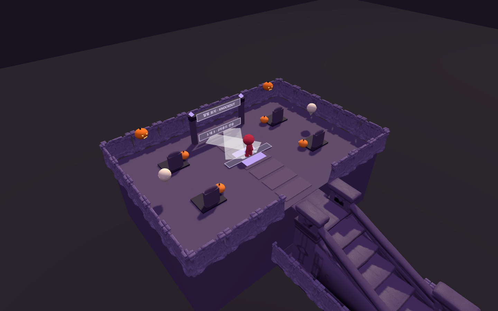
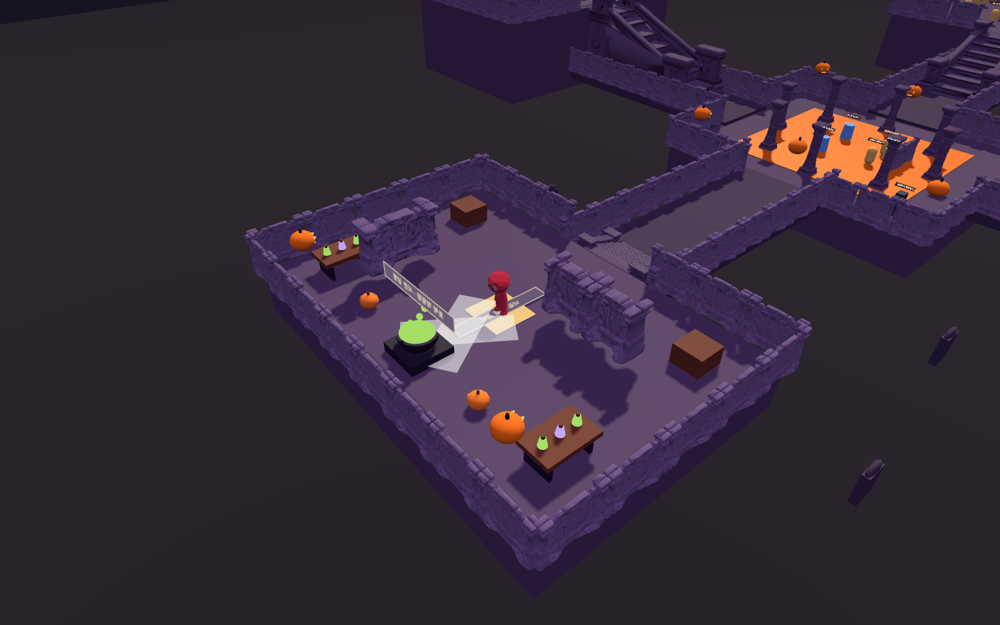

# 베타 시즌 8 로비의 두 방

2026-10-20 · 베타 0.8.20

남쪽 달빛 묘지(0, 40)와 동쪽 호박 작업장(40, 0)에 시즌 테마 장식과 실제 입구 기능을 배치했습니다. 두 방의 바닥 높이는 각각 8.2 / 3타일입니다. 기존 계단과 연결 통로를 사용합니다.

- 달빛 묘지: 묘비 4개, 호박, 떠다니는 유령 2개, 보라색 조명, 중앙 돌길, 녹아웃 안내문.
- 호박 작업장: 물약 작업대 2개, 물약 가마와 움직이는 거품, 호박, 보관 상자, 시즌 상점 안내문.
- 방 중앙 3.2타일 안에서 E 또는 안내 버튼으로 입장합니다. 묘지는 기존 3대3 녹아웃, 작업장은 기존 시즌 상점을 엽니다.
- 빠른 이동 버튼은 로비에서만 동작합니다. 경기 시작 시 장식과 안내를 숨기고, 종료 시 로비와 함께 복원합니다.
- 가구에는 이동 충돌만 추가하며 발판으로 사용하지 않습니다. 중앙과 계단 입구는 비웁니다. 베타 시즌 7과 메인은 변경하지 않습니다.

## 검증

`node tools/test-beta8-lobby-rooms-browser.mjs` — 실제 Edge에서 다음을 확인했습니다.

- 빠른 이동 후 바닥 높이·위치·안내 버튼 표시.
- 두 방의 계단 입구와 중앙 통로에서 보행 가능·가구 겹침 없음.
- 상점 열기 시 크레딧 유지, E로 녹아웃에 6명 입장.
- 경기 중 빠른 이동 잠금·로비 장식 숨김, 종료 후 로비 복원.
- 시즌 7에는 방 콘텐츠·버튼 없음, 페이지 예외 0건.

`npm.cmd run check`, 신규 모듈 구문 검사 통과. 배포 사이트 검증은 포함하지 않습니다.

[상세 결과](beta8-lobby-rooms-verification.json)

## 화면

